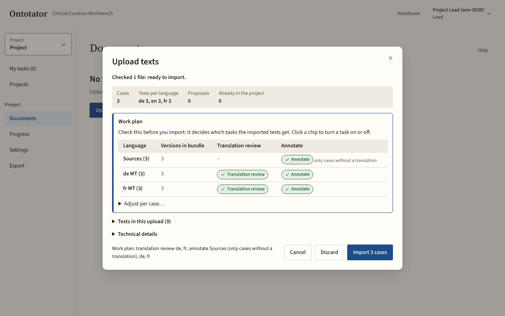
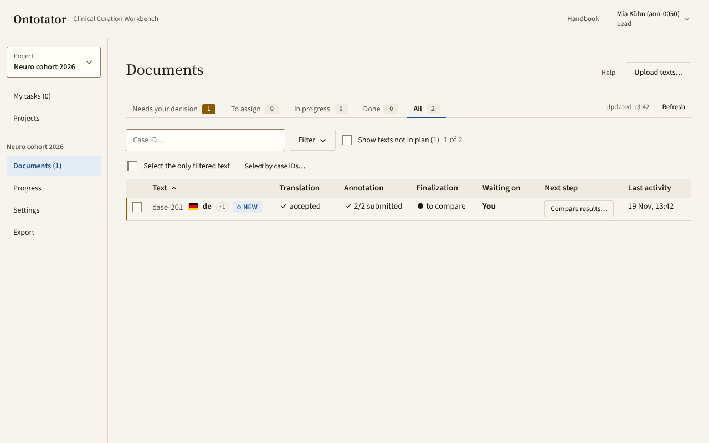
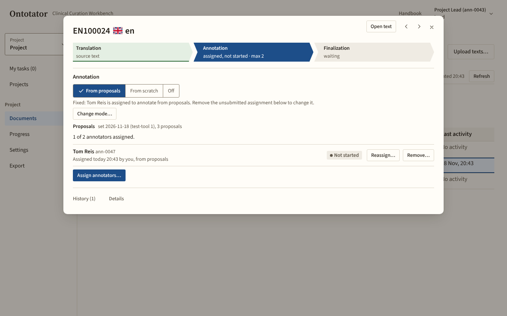
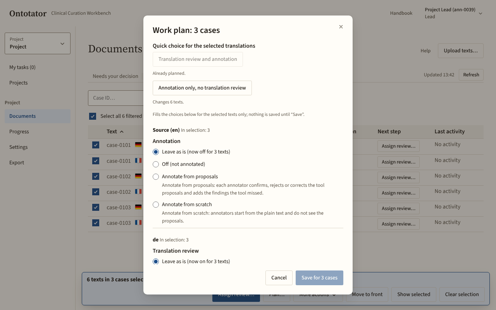
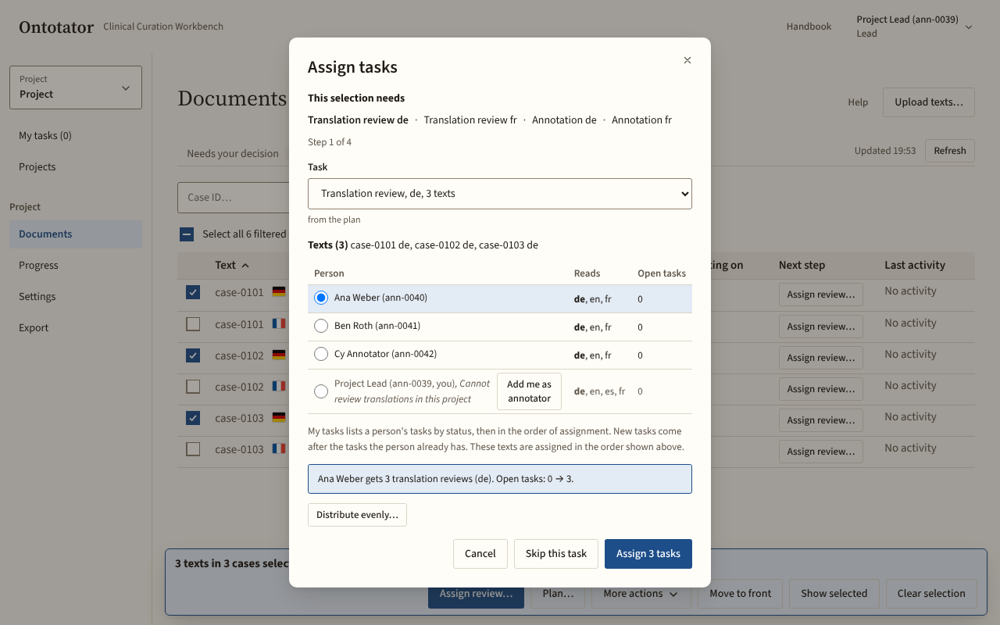
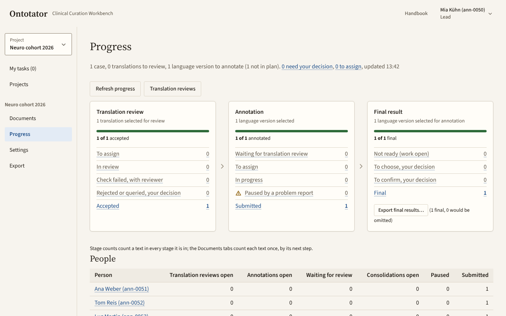

# Lead: texts, work plans and progress

This chapter is for project leads. It covers the **Documents** page: uploading texts, the text card, planning and assigning work, and following progress. Back to the [lead overview](lead.md).

On **Documents**, each row is one text: one language version of a case. See [case, text and document](README.md#glossary).

## Upload texts

### Prepare files for upload

Ontotator takes two formats:

| Format | Use it for | What goes in |
| --- | --- | --- |
| **Plain text** (.txt, or a .zip of .txt files) | Texts in one language, without tool proposals. | One UTF-8 text file per text. The file name without `.txt` becomes the text's ID: letters, digits, dots, hyphens and underscores, up to 128 characters, starting with a letter or digit. Each name may occur once. All files of one upload get the same **Upload language**. |
| **Ontospan bundle** (.zip or .json) | Texts with translations and tool proposals. | A ZIP with `manifest.json` and one JSON file per text under `documents/`, or a single exchange file (.json). Each text file holds the text, its language and case ID, whether it is a translation, and the tool proposals for it. |

Example of a plain-text ZIP:

```
texts.zip
  case-201.txt
  case-202.txt
```

Example of an Ontospan bundle:

```
bundle.zip
  manifest.json
  documents/
    case-201-de.json    (source text, with proposals)
    case-201-en.json    (translation of case-201)
```

Ontospan bundles are written by the Ontospan tools that produce the translations and proposals. Ask whoever runs those tools for a bundle.

Only proposal sets of kind `tool_output`, whose every author is a tool, can be imported. A newly imported proposal set is used only by annotation rounds that start after the import; tasks keep the proposals their round started with. See [Work from new tool proposals](lead-change-course.md#work-from-new-tool-proposals).

A bundle fits a project only if its ontology ID, layer IDs, ontology release, branches, annotation scheme and values match the project's [task profile](lead-settings.md#task-profiles) and ontology settings. The built-in template *HPO phenotype* fits only bundles with ontology `hp`, layer `hpo-layer` and exactly the branch `HP:0000118`. See [What must match a bundle](lead-settings.md#what-must-match-a-bundle).

### Corrections and parallel translations in a bundle

A bundle can also bring a new version of a translation the project already has, or a second translation of the same source. Each text file names its version in `document.variant`:

| What you bring | `document_id` and `language` | `variant` | `translation` |
| --- | --- | --- | --- |
| A new version (correction) of a translation | The same as the translation it corrects | `version` one higher than the newest version, `origin`: `correction`, `derived_from`: the `text_sha256` of the version it corrects | Not allowed: the bundle is refused with `translation_unexpected`. The provider or model cannot be recorded. |
| A parallel translation of the same source | A new `document_id`, the same `case_id` and `language` | `version`: 1, `origin`: `machine_translation` or `human_translation`, `derived_from`: the `text_sha256` of the source text | The run that produced it: `provider`, optionally `model` and the automatic checks. |

From format 1.3, a new translation can carry `translation.review` with `status`: `reviewed` (and optionally `reviewer`, `reviewed_at` and `note`). Ontotator then accepts it at import as *marked as reviewed in the package*. A correction cannot carry it, as it has no `translation` part; accept it after the import ([Use another translation of a text](lead-change-course.md#use-another-translation-of-a-text)).

### Upload texts

What for: bring texts into the project, with or without tool proposals.

Before you start: [prepare the files](#prepare-files-for-upload). Check the [languages of the texts](lead-settings.md#set-the-languages-of-the-texts) and the [plan for new imports](lead-settings.md#choose-the-plan-for-new-imports).

1. Open **Documents** and click **Upload texts…**.
2. Choose the **Format**. For plain text, also choose the **Upload language**.
3. Click **Choose files…** and select your files.
4. Click **Check**. Nothing is imported yet; the dialog shows *Checking 2 files …*.
5. Read the preview: the number of cases, proposals and texts already in the project, and any **Notes**. **Texts in this upload** lists every text; under **Show**, choose for example **Corrections** to see only new versions of translations. For plain text, the first note shows which text ID each file name became. A note says what, if anything, you need to do; **Show** lists the texts and proposals it concerns.
6. Check the **Work plan** before you import: it decides which tasks the imported texts get. For each language, click a chip to turn the **Translation review** or the annotation on or off. Sources marked *only cases without a translation* are annotated only where a case has no translation. Click **Adjust per case…** for exceptions. The line next to the import button repeats the plan, for example *Work plan: translation review de; annotate de*.
7. Optional: if translations are not marked as reviewed and you want them annotated without review, tick **These translations were reviewed outside Ontotator — accept them as they are** and enter a **Reason**. This applies only to texts new to the project, not to a new version of a text already in it.
8. Click the import button, for example *Import 20 cases*.



What you may see:

| Message | Meaning |
| --- | --- |
| *…: problems found. Nothing can be imported.* | The dialog names the problems per file and, for a bundle that does not fit the project, what the bundle uses, what the project uses and who can change it. Click **Discard** (or **Cancel**): the upload is dropped and the dialog closes. Fix the files or the settings and upload again. |
| **You can close this dialog; the import continues, and the texts appear after the next page load.** | The import runs. Reload **Documents** later. |
| *Imported 20 documents and 35 proposals.* | The import is done. |
| **This upload failed. Nothing was imported.** | **Discard it and upload the files again.** |

If you chose **Plan nothing; I plan texts on Documents**, the new texts appear as *Not decided* until you plan them ([Plan several texts at once](#plan-several-texts-at-once)).

## The Documents page

The **Documents** page lists every text of the project and what it needs next. Open it with **Documents** in the sidebar. A number next to it counts the texts that need your decision.



### Columns of the Documents table

| Column or mark | Meaning |
| --- | --- |
| **Text** | The case ID, the language, the text version and a **NEW** badge for texts that are new since your last visit. |
| **Translation**, **Annotation**, **Finalization** | The state of each stage, with the names of the people involved. Below 1600 px width the state is shorter and the names are left out; see [On a narrow screen](#on-a-narrow-screen). |
| Robot icon | The text has tool proposals. |
| **Waiting on** | Who the text waits for. **You** in bold means it waits for you. |
| **Next step** | A button for the next action on this text, for example **Assign annotation…**, **Accept result…** or, when submissions differ, **Compare results…**. Rows that need your decision also have a coloured left edge. |
| **Last activity** | When something last happened on the text. |

A task starts with the person's first saved change; opening it is not enough, and neither is ticking checked sentences in a translation review. Until then **Translation** and **Annotation** read *assigned, not started* with the person's name, in the table (*not started* without the name below 1600 px), its tooltip, the narrow cards and the text card, where the person's row shows **Not started**. After the first save they read *in review* or *In progress*. With several people or parallel versions the cell counts them, for example *1 of 2 started*.

The counts in **Annotation**, for example *0 of 1 submitted*, count only work on the newest version of the text. After a text change, a submission on the old version no longer counts: neither when it was carried to the new version, nor when the new version was started fresh. Carried work counts once it is submitted on the new version.

### Use the Documents tabs

What for: work through texts by what they need.

1. On **Documents**, choose a tab: **Needs your decision**, **To assign**, **In progress**, **Done** or **All**.
2. Click **Refresh** to reload the table and the counts.

A tab keeps your filters and search. A text that leaves the tab while you work on it, for example one you just assigned under **To assign**, stays in the table with a *Changed: …* or *Resolved* badge, so the list does not jump. **Refresh** or another tab removes such texts.

### Do a text's next step

What for: act on a text directly from its row.

1. In the **Next step** column, click the row's button, for example **Assign annotation…**, **Accept result…** or **Decide on report…**.
2. The matching dialog, card or page opens. The tasks in this chapter and in [Lead: results, decisions and export](lead-results.md) describe each one.

If you have an open task on the text yourself, the row shows **Open my task** instead. It opens your task in the editor or on the consolidation screen.

### Search texts

What for: find a text by its ID. The search does not look at the words in the text.

1. Type into the search field **Case ID…**. Any part of the ID is enough, in upper or lower case: `fr100994` and `100994` both find `FR100994`. To find one language, add it: `FR100994 fr`.
2. The list updates after a short pause or when you press Enter.

The search stays inside the open tab. If it finds nothing there but finds texts under another tab, the list says so and offers a button to show them under **All**, with your search kept.

To clear the search, click ✕ in the field.

### Filter the list

What for: show only texts in a certain state, language or origin, or the texts of one person.

1. Click **Filter**.
2. To see what a person was given, choose them under **Assigned to**. The list shows their texts in every task, open and submitted; revoked assignments are left out.
3. Tick the options you need, for example under **Language**, **Translation review**, **Annotation** or **Final**. Each choice applies at once.
4. Under **Order**, choose **Case ID**, **Import order** or **Last activity**.

Active filters show as chips above the table. Remove one with its ✕, or click **Clear all**. Options without texts are hidden; click the button below the options, for example *Show 4 empty filters*, to see them.

To find texts with more annotators than **Annotators per text** allows, for example after you lowered the limit, tick **More annotators than the limit** under **Flags**. It counts the unremoved annotation tasks of a text's current version, open and submitted. A text with its own limit ([Assign work for one text](#assign-work-for-one-text)) is measured against that limit, not the project's. To withdraw the extra open tasks, select the texts and use [Withdraw open tasks…](#reopen-or-withdraw-the-tasks-of-several-texts).

### Sort and page through the table

- Click the column header **Text** to sort by case ID, up or down.
- Click **Last activity** to sort newest or oldest first.
- The other headers sort only the rows on the current page.
- Below the table, click **Next** or **Previous** to see more rows.

### On a narrow screen

Below 1600 px width each text keeps one line in the table. Where the table is still wider than the page, it scrolls sideways with the **Text** column kept at the left:

- The stage columns show a shorter state and leave out the names, which **Waiting on** already shows. For example *assigned, not started (Ana Weber)* reads *not started*, *1 of 2 submitted* reads *1/2 submitted*, *ready to compare* reads *to compare* and *Final is on old text* reads *on old text*. Submitted work from proposals that waits for the new version's proposals reads *v1 work waits* (*v2 has no proposals yet*).
- **Waiting on** shows one name and *+n* for the others.
- **Text** keeps *source*, the version marker and **NEW** on the line and cuts a long case ID with *…*.
- Point at a cell to see the full state with the names in its tooltip. Screen readers read the full state.

Below 700 px width, each case is a card with its texts. Click a stage status to see the latest activity and the actions for that stage. Click **Details** to open the full text card.

## The text card

The text card shows everything about one text and lets you act on it.

### Open the text card

1. Double-click a row, or focus the text name and press Enter.
2. The card shows the path **Translation**, **Annotation**, **Finalization**. Click a part to see it. The card opens on the part that needs work now, or on the part with your next step.



In the card:

- **Open text** opens the [text view](#read-a-text-and-other-peoples-work-in-the-text-view).
- **Previous text** and **Next text** walk through the table (keys `K` and `J`).
- **Other languages** switches to another language of the same case. Below 700 px width it shares a line with **Open text**.
- Your steps stand where they act. An open problem report is a notice above the path with **Open** and **Decide on report…**. Other steps stand at the top of their part under *Next step*, for example **Resolve…** in **Translation** or **Carry to v2…** in **Annotation**. A part's other actions share its action row, for example **Open result**, **Change final…** and **Withdraw final…** in **Finalization**.
- Every person's remove action is **Remove…**. Its dialog says what happens: an unsubmitted annotation is removed with its draft; other work is revoked and stays in the history.
- In **Annotation**, a text with tool proposals names the proposal set its annotators work on, for example *Proposals set 2026-10-02 (phentrieve 1.4), 24 proposals*. When a newer set was imported for the text and a task still works on an older one, the line names the older set and *Newer set available: 2026-11-10* follows, with **How to use it** ([Work from new tool proposals](lead-change-course.md#work-from-new-tool-proposals)); it goes away once every task of the text is on the newest set. Tasks that started before sets were recorded show *set not recorded*. A person's row names the set only when it differs from the text's, for example *newest set*.
- When a text has more than one version (for example after a translation correction), each person's row in **Annotation** ends with the version their task or submission is on, for example *Submitted 22 Oct, 14 findings · assigned 15 Oct · v1* and *Assigned 18 Oct by you, from proposals · v2*; the row of a running consolidation in **Finalization** names it the same way. With parallel versions the row names the version chain too, for example *DeepL v2*. A text with one version shows no version in these rows. A translation reviewer's row always says *Review of v2*.
- In **Finalization**, **Open consolidation** opens your own running consolidation as your task; a submitted one opens read-only.
- In **Finalization**, when submissions differ, the agreement line is followed by the findings that differ in detail; a term and its parent or child on the same passage are named as *Related terms: …* (see [Accept a result or compare results](lead-results.md#accept-a-result-or-compare-results)).
- ✕ or Esc closes the card.

### Read the history and details of a text

What for: see what happened to a text and its technical IDs.

1. In the text card footer, click **History** or **Details**. The view's name stands next to **Back** at the top of the card.
   - **History** lists all activity, newest first, with reviewers' reasons, reassignments and mode changes.
   - **Details** shows the **Plan**, the **Problem reports** and the **Technical details**. Each problem report shows its title, then who reported it, when, its state and the paused tasks, then **Open report**. In the **Technical details**, the lines **Submission ID** and **Round ID** name the person and the version, for example *Submission ID, ann-0004, v1*.
2. Click **Back** to return to the path.

### Read a text and other people's work in the text view

What for: read a text with other people's findings or the final result, and compare two of them side by side. Leads and consolidators see other people's work; everyone else sees only their own.

1. Open the text view with **Open text** in the text card.
2. Choose the language and version in **Language and version**.
3. In **Show**, choose **Text only**, a proposal layer, someone's annotations or the result. Its findings are listed under **Findings**.
4. Optional: click **Compare** to open a second pane. Each pane has its own **Language and version** and **Show** directly above its text: **Current text** on the left, **Comparison text** on the right, so both texts start at the same height. Tick **Couple scrolling** to scroll both together. Click **Close comparison** to close it.
   - When both panes show texts of the same language, for example v1 and its correction v2, tick **Show changes** to see what changed. The older version strikes through the removed passages, the newer version underlines the added ones; the line above the texts counts them. The marks do not change the texts, the findings or **Couple scrolling**. A change of spaces or line breaks only is not marked or counted. If the two texts have little in common, the line reads *The texts differ too much to show the changes* and nothing is marked.
   - When **Show** has someone's annotations that were carried from an earlier version of the text (after **Carry to v2…** or **Handle text change…**), tick **Show changes since** v1 above the text: changed passages get a dashed frame, added text is underlined, and a **−** marker shows the earlier wording of removed text. **Next ›** and **‹ Previous** step through the passages. The annotator sees the same marks in their task. Not offered while **Compare** is open, which has its own **Show changes**.
5. Optional: click **Submissions** to open the **Submission history**. Choose a row to show it, then click **Close**. Each finding names its author by pseudonym; leads always see them, also when the project hides annotator names from consolidators.

**Open my task** goes to your own task on this text.

### Review the translation versions of a text

What for: see each version of a translation, its reviews and its origin.

1. Open the text card and click **Translation**.
2. The list shows each version with its origin and status, then one row per person who worked on it: the name, the task and the status. Older ones are under **Older versions**; with parallel versions they are grouped by version chain.
3. Click **View text** to read a version, or **Translation reviews** to see every review decision. In a reviewer's row, **Reopen…** lets them review the version again and **Remove…** removes their assignment.
   At the newest accepted version, **Correct the translation…** lets you correct it yourself ([Correct a translation yourself](lead-results.md#correct-a-translation-yourself)). At the newest version that is neither reviewed nor accepted, **Accept this version…** accepts exactly that version ([Accept one translation version](lead-results.md#accept-one-translation-version)).
4. Click **Compare with source** to compare the translation with the source text.

### Request a translation correction

What for: have a translation corrected by a reviewer.

1. Open the text card and click **Translation**.
2. At the version, click **Request correction…**. It is offered only at an accepted version; for a rejected or queried one, use **Resolve…** ([Resolve a rejected or queried translation](lead-results.md#resolve-a-rejected-or-queried-translation)).
3. Choose the **Translation reviewer** and enter the **Reason for another review**.
4. Click **Assign correction review**, then **Close**.

If the reviewer submits **Accepted with corrections**, the corrected text becomes a new text version. While a lead is correcting the same version themselves, the request is refused with *A lead is correcting this version.* ([Correct a translation yourself](lead-results.md#correct-a-translation-yourself)).

## Work plans and assignments

The work plan says, for each text, whether it gets a translation review and whether and how it is annotated. Planned texts show up in the main list; the others are hidden. Then the tab **All** says how many of its texts the table holds, for example *246 of 307*.

### Add a text to the plan

What for: start work on a text that is not planned yet.

1. On **Documents**, tab **All**, tick **Show texts not in plan**. Unplanned texts appear muted.
2. In the text's row, click **Add to plan…**.
3. Choose **Translation review** **On** or **Off**.
4. Choose the annotation: **Off (not annotated)**, **Annotate from proposals** or **Annotate from scratch**.
5. Click **Save**. The message has an **Undo** button.

### Select texts

What for: plan or assign many texts at once.

1. Click a row to select it. Shift+click selects a range; Ctrl+click (macOS: Cmd+click) adds single rows.
2. To select every filtered text, tick the checkbox in the table header.
3. The selection bar at the bottom shows how many texts are selected and their next steps, for example *next steps: Assign annotation (en, es)*. Selected texts the filters hide are counted too, and the bar says so, for example *4 texts in 2 cases selected (2 source texts not shown)*.

To list only the selected texts, across all pages, click **Show selected**. The list then ignores the tab and the filters and shows the chip **Selected texts**. Click **Show selected** again or remove the chip to return to your filters and page; changing a filter or tab also ends it.

To start over, click **Clear selection**.

### Select texts by pasting case IDs

What for: select texts from a list you have elsewhere, for example a spreadsheet.

1. Click **Select by case IDs…**.
2. Paste the IDs into **Paste case IDs**, one per line or separated by commas.
3. Check how many were found. Click **Copy unknown IDs** to copy the ones that do not exist.
   Case IDs are case sensitive, and two cases can differ only in case. An exact ID always wins. An ID in another case, for example `fr100907`, finds `Fr100907` when that is the only case ID that fits; the dialog lists it under *Matched in another case*. When several case IDs fit and none exactly, the dialog selects none of them and says so, for example *fr100907 matches FR100907 and Fr100907; enter the exact ID.*
4. Optional: to select every other text instead, tick **Select all except these**. The dialog then selects the texts that match the current tab, filters and search, except the texts of the pasted cases, and says how many, for example *120 other texts in 60 cases match the current filters.* These are the texts the table shows: texts not in plan count only while **Show texts not in plan** is ticked. This takes at most 5000 case IDs.
5. Optional: to keep the current selection, tick **Add to the current selection instead**.
6. Click the select button, for example *Select 20* or *Select 120 other texts*.

A selection holds the texts of at most 2000 cases. With more, the dialog selects the first 2000 in list order and says *Selection is limited to 2000 cases.* Plan, assign or move one part, then select the next part. A plan save or an assignment also takes at most 2000 cases at once.

### Plan several texts at once

What for: set the work plan for a selection.

1. Select the texts, then click **Plan…** in the selection bar.
2. Optional: under **Quick choice for the selected translations**, pick **Translation review and annotation** or **Annotation only, no translation review**.
3. Or set it per language: **Translation review** and **Annotation**. **Leave as is** keeps the current plan.
4. Read what will change.
5. Optional: enter a **Reason (optional)**, for example *Adults only in this study*. It is kept with the change. When you take texts out of the plan, the final export names them with this reason. When you accept translations as reviewed outside Ontotator, the **Reason** is required and also recorded with the acceptance.
6. Click the save button, for example *Save for 20 cases*.
7. If work already exists, the dialog lists what happens to it. Tick **I understand** (or **I understand — withdraw the open tasks**) and save again.



**Undo** in the message restores the plan and the final results as they were, without asking you to confirm them again. It does not restore withdrawn tasks; withdrawn tasks keep their drafts. If the change withdrew tasks, the message after the Undo offers their texts, for example *Select the 2 texts with withdrawn tasks*. Click it to select them, then [assign the work](#assign-work-to-the-selected-texts) again. This works the same for the plan chips of one row. The offer stays until you close the message.

### Change the annotation mode of one text

What for: switch one text between from proposals, from scratch and not annotated.

1. Open the text card and click **Annotation**.
2. Under **Annotation**, choose **From proposals**, **From scratch** or **Off**. It saves at once.

Once someone is assigned, started or submitted work, a line *Fixed: …* says who fixes the mode:

- While the work is not submitted, remove the assignment ([Remove, reassign or reopen an assignment](#remove-reassign-or-reopen-an-assignment)), then choose.
- To change it anyway, click **Change mode…** next to the line. The dialog names whose work is affected. Enter the **Reason**, then click **Change mode**, or **Discard work and change mode** if submitted work is discarded. Their assignments are removed. Discarded work is kept, not deleted: it no longer counts for progress, consolidation, the final result or exports.
- The mode change always discards the work of the whole text, never of single people.
- Once a final result is chosen, the mode is locked: **Change mode…** is refused and the dialog says *A final result was chosen for this text, so its annotation mode stays.* The API and the MCP server refuse it with the error code `ANNOTATION_MODE_FINAL_SELECTED`. Withdraw the final result first ([Withdraw a final result](lead-results.md#withdraw-a-final-result)), then change the mode.
- **Restore…** in the text card brings the discarded work back while no new annotation has started.

**History** in the text card shows the change and its reason.

For many texts at once, see [Change the annotation mode of several texts](#change-the-annotation-mode-of-several-texts).

### Assign work to the selected texts

What for: give translation reviews or annotations to people.

1. Select the texts, then click the assign button in the selection bar, for example **Assign annotation…**.
2. Check what the selection needs. If it needs more than one task or language, the line **This selection needs** lists every step, one task in one language each, for example *Translation review de ✓ · Annotation de · Annotation en*. Steps you are through have a tick, a skipped step reads *(skipped)*, the current step is bold, and *Step 2 of 3* says where you are. Then check the **Task**. Annotation that waits for a review you skipped is no longer listed: it cannot start in this dialog.
3. In the table of people (**Person**, **Reads**, **Open tasks**), pick the reviewer, or tick everyone who should annotate. The task has one language: each ticked person gets every selected text in that language that still has a free place. *Administrator* marks a system administrator; leave them unticked unless they take part.
4. Read the summary below the table, for example *Ana Weber gets 3 translation reviews (de).*
5. Click the assign button, for example *Assign 20*.



Texts that already have a final result are left out, also when you assign one text: the dialog says *This text is at another step of the plan.* See [More annotators on finished texts](lead-change-course.md#more-annotators-on-finished-texts).

**Reads** shows the languages in each person's profile. If someone's profile lists languages but not one the task needs, the dialog asks again; click **Assign anyway** or **Back**. A person with no languages listed counts as unknown and gets no warning. Ontotator sends no e-mail; the work appears in each person's **My tasks**.

With **Annotate only after the translation review is accepted** on, you can assign annotators to a text while its translation review is assigned or underway, so both steps are set up at once. The summary says *Still in translation review: the task opens once the review is accepted.* The annotator sees the task in **My tasks** as **Waiting for translation review** and cannot start it; it counts under **Open tasks**. When the review is accepted, the task opens with no further step from you. This also holds for **Distribute evenly…**. A text with no translation review under way still cannot get annotators: assign the review first. With parallel translations of one text, only the translation under review can get a waiting task; the others follow once every translation is accepted, and the dialog's summary says which were left out.

What happens to a waiting task:

- **Rejected** or **Query**: it keeps waiting. Decide on the text as usual.
- **Accepted with corrections**, a lead correction or an uploaded correction: the task moves to the new version and opens there once that version is accepted. A task from proposals waits on the old version: the annotator sees **Waiting for the project lead**, and once the new version is accepted the text shows **Handle text change…**. There you move the task to the new version, where the decisions on the proposals are carried and only changed passages need a check. If the new version has no proposals yet, moving is not available: wait for them (their automatic transfer may still be running) or import them, click **Retry**, then move the task. A paused task stays too, until you decide its report.
- A task on an uploaded correction that was then **Rejected** or **Query**, with the older version accepted afterwards: the text shows **Handle text change…**; **Withdraw** the task, then assign the accepted version.
- You remove the review: the task keeps waiting, and the text shows the next step for the review.
- You turn Review off and accept the translation: the task opens. You turn Annotate off or discard the version: the task is withdrawn, as any open task.

The dialog works through the whole selection, one task and language at a time: translation reviews first, then annotation. After the assign button it stays open on the next step, lists what is already assigned and says what comes next. An annotation that waits for its review is the next step once the review is assigned. To pass a step without assigning it, click **Skip this task**; to go to another step, choose it under **Task**. Click **Close** when you are done, or assign the last step.

The closing message appears once the table shows the new assignments. It names what is left unassigned, for example *Left unassigned: annotation of case-0102 en*, and offers those cases, for example *Select the 2 skipped cases*. The message stays until you close it.

### Reopen or withdraw the tasks of several texts

What for: let the annotators revise many texts at once, for example after a guideline change, or take open tasks back, for example the annotations above a lowered **Annotators per text**.

1. Select the texts, then click **More actions** in the selection bar.
2. Choose **Reopen…** for submitted tasks, or **Withdraw open tasks…** for tasks not submitted yet. An entry that does nothing for the selection stays in the menu, unavailable, and says why, for example *No submitted tasks in the selected texts.*
3. Under **Tasks**, tick which tasks: **Annotations** (ticked at first), **Translation reviews** or **Consolidations**.
4. For **Withdraw open tasks…**: by default only tasks nobody has started are withdrawn. Tick **Also withdraw started tasks** to include tasks in progress or reopened; their drafts are kept. Tick **Only annotations above the limit of annotators per text** to keep the limit's number of annotations per text (a text's own limit where it has one) and withdraw only the open ones above it. Submitted work stays first, then started work, then the earliest assigned.
5. Read the preview. It groups the tasks by what happens to them and names the people with their number of tasks, for example *Reopen 9 submitted tasks · Tom Reis 5, R. Roe 4*. Click **Show all** to list every text of a group. What stays as it is has its own group with the reason, for example:
   - *Skip 3 texts · final result chosen: use Change final… first*: texts with a final result are not reopened.
   - *Keep 2 open tasks · not submitted yet*: there is nothing to reopen yet.
   - *Keep 1 started task · work has begun: tick “Also withdraw started tasks”*: started tasks (unless ticked), tasks paused by a problem report and lead corrections are not withdrawn; each has its own group.
6. Enter the **Reason**. For **Reopen…** it is required: the people see it in **My tasks**. For **Withdraw open tasks…** it is optional (**Reason (optional)**). It is kept in each text's history.
7. Click the button that names the work, for example *Reopen 14 assignments*. The dialog lists what happens. Tick **I understand** (or **I understand — withdraw the open tasks**) and click the button again.

Every listed task changes, or none: if the texts changed since the preview, the dialog says *The texts changed since the preview. Check the new preview.* and shows it. Each task is recorded in the audit trail as a single reopen or withdrawal would be, so the history of every text shows it.

**Undo** in the message, for example *Reopened 14 assignments in 12 texts.*, takes the change back: reopened tasks count as submitted again; withdrawn tasks come back with their drafts. Undo is for the lead who made the change, once, within an hour, and only while nothing changed on these texts since: nobody saved a draft, nobody was assigned, the plan, the final result and the text version are the same. Otherwise the message says *Undo is no longer possible: the texts changed since.*

The same menu holds **Accept agreeing results…** and **Change final…** for the final results of the selected texts: see [Accept or change the final result of several texts](lead-results.md#accept-or-change-the-final-result-of-several-texts).

### Start a new round for several texts

What for: give submitted annotations a new work round, for many texts at once. Either the people continue from what they submitted, or they start again without their earlier findings, for example on tool proposals imported after they began ([Work from new tool proposals](lead-change-course.md#work-from-new-tool-proposals)). It also works for a single selected text.

1. Select the texts, then click **More actions** in the selection bar and choose **Start a round…**. When the selection has nothing to start a round for, the entry is unavailable and says why, for example *No submitted annotations in the selected texts.*
2. Under **New round**, choose how the round starts:
   - **Continue from the submission**: the new round starts with what the person submitted. They check it, change it and submit again.
   - **Restart**: the new round has none of the earlier findings. A task from scratch starts empty; a task from tool proposals starts again from the newest proposals, all open.
3. Read the preview. It names the people with their number of tasks, for example *Continue 7 submitted tasks in a new round · Tom Reis 5, R. Roe 2*; click **Show all** to list every text. Only submitted annotations on the current version of a text get a round. What stays as it is has its own group with the reason:
   - *Skip 1 text · final result chosen: use Withdraw final… first*: the final result rests on a submission ([Withdraw a final result](lead-results.md#withdraw-a-final-result)).
   - *Skip 1 text · a consolidation is open: finish or withdraw it first*: the consolidation works on the submissions.
   - *Keep 2 open tasks · not submitted yet*: tasks that are assigned, in progress or reopened are not touched.
   - Also kept, each in its own group: a task paused by a problem report, a task on an earlier or discarded version, a task whose person can no longer take it, a task whose translation is not accepted yet and, for **Restart**, submitted work without a work round (older or imported work: use **Reopen…**).
4. Enter the reason. For **Restart** it is required (**Reason**); for **Continue from the submission** it is optional (**Reason (optional)**). It is recorded with each new round in the audit trail.
5. Click the button that names the work, for example *Start 7 rounds*. The dialog says what happens. Tick **I understand** (for a restart **I understand — restart without the earlier findings**) and click the button again.

What happens to the work:

- Each person gets the task back in **My tasks** and must submit again. The earlier submission no longer counts as submitted; it stays in the history and the earlier rounds stay readable under **More** › **Work rounds**.
- After **Restart** the submitted work is set aside: it is not carried into the new round.
- Every listed task gets its round, or none: if the texts changed since the preview, the dialog says *The texts changed since the preview. Check the new preview.* and shows it. Each round is recorded in the audit trail like a single new round.
- This action has no undo, and no action on a single text brings back a round that was replaced. To let people only correct a submission in place, use **Reopen…** instead.

### Change the annotation mode of several texts

What for: switch many texts that already have annotation work between from proposals and from scratch, for example when the tool proposals turn out unusable, or usable after all. For each text it does what **Change mode…** in the text card does ([Change the annotation mode of one text](#change-the-annotation-mode-of-one-text)): the annotation of the text starts again, and the work on it is discarded.

1. Select the texts, then click **More actions** in the selection bar and choose **Change mode…**. When no selected text can change its mode, the entry is unavailable and says why, for example *No annotation work on the selected texts yet: set the mode with Plan….*
2. Under **Annotate the texts**, choose **From scratch** or **From proposals**. Neither is chosen at first. Each option says how many of the selected texts it changes.
3. Read the preview. The first group names the texts that change and the work that goes, for example *Annotate 4 texts from proposals · discards 6 submissions, removes 2 unsubmitted assignments*; click **Show all** to list every text. Below it, a list names every person affected, for example *Tom Reis: 4 submissions are discarded.* and *R. Roe: 2 submissions are discarded; 1 unsubmitted assignment is removed.* Consolidations are named as such. Texts that keep their mode have their own group with the reason:
   - *Skip 1 text · final result chosen: use Withdraw final… first*: a final result rests on the work ([Withdraw a final result](lead-results.md#withdraw-a-final-result)).
   - *Skip 2 texts · no annotation work yet: set the mode with Plan…*: nothing fixes the mode of these texts; **Plan…** or the text card sets it directly.
   - *Skip 6 texts · already annotated from scratch*: the text is already annotated this way.
   - *Skip 1 text · no tool proposals for the text*: only a text with tool proposals can be annotated from proposals.
4. Enter the **Reason**. It is required and recorded with each text's change.
5. Click the button that names the work, for example *Change mode of 4 texts*. The dialog says what happens and lists the people again. Tick **I understand — discard the work and change the mode** (**I understand** when no submitted work is discarded) and click the button again.

What happens to the work:

- The mode change always discards the work of a whole text, never of single people: every submission on it (annotations and consolidations) is discarded and every assignment is removed, also those in progress. Drafts are kept. Discarded work is kept, not deleted: it no longer counts for progress, consolidation, the final result or exports.
- The texts have no annotators afterwards: assign them again ([Assign work to the selected texts](#assign-work-to-the-selected-texts)).
- Every listed text changes, or none: if the texts changed since the preview, the dialog says *The texts changed since the preview. Check the new preview.* and shows it. Each text is recorded like a single mode change, so **History** in its card shows the change and the reason.
- There is no undo for the whole action. **Restore…** in a text card brings the discarded work of that text back while no new annotation has started on it.

- Reopened translation reviews have no Undo: the review starts again from the current text of its version, and the earlier draft cannot be brought back. The dialog says so before you confirm. The submitted decision stays in the history.
- Undo is recorded as a change of its own. A person who has the task open may be asked to reload it.

### Move texts to the front of the queue

What for: have some texts done first, for example a batch uploaded later that is now urgent.

**My tasks** lists each person's open tasks by status, then in the project's order: first imported first. To change that order:

1. Select the texts, then click **Move to front** in the selection bar.
2. Read the confirmation **Move to the front of the queue** and click the button that names the texts, for example *Move 2 texts to the front*. Or click **Cancel**, or press Escape, to keep the order.

The selected texts now come first, in their earlier order among themselves; the other texts follow in theirs. The message says how many texts moved, for example *2 texts moved to the front of the queue.* The order applies to tasks already assigned and to tasks you assign later, and **Import order** under **Order** on **Documents** follows it. A later upload comes last again. Each move is recorded in the audit trail. There is no Undo: to change the order again, move other texts to the front.

### Assign work for one text

What for: assign a single review or annotation.

1. In the row, click **Assign review…** or **Assign annotation…**. In the text card, use **Assign review…** or **Assign annotators…**.
2. Tick the people. To annotate yourself without the Annotator role, click **Add me as annotator**.
3. Click the assign button, for example *Assign 2 people*.

To change the limit of annotators per text from here, click the info button (i) next to the limit and enter the number:

- **Only for the selected text** (with several texts: **Only for the selected texts**) gives these texts their own limit, for example 4 annotators on one text for a method comparison in a project with 1. Click the button that names the number of texts, for example *Change for 1 text*. The text keeps its own value for every version, also a corrected one; the project setting and the other texts stay as they are. Entering the project's number again returns the text to the project setting. The popover then explains *Sets the most annotators for this text only (project: 1)*, and for a text that already has its own value its title reads, for example, *Up to 4 annotators for this text (project: 1)*.
- **For all texts** changes the project setting. Click **Change for all texts**. Texts with their own value keep it.

The text card then shows *Annotators: 4 for this text (project: 1)* in **Annotation**. Lowering the number removes nobody: annotators already assigned stay, and the popover says so, for example *This text already has more; its assignments stay.* Several selected texts change together or not at all. When the selected texts have different limits, the dialog says *limits differ*, lets you tick as many people as the text with the highest limit takes, and each text gets only as many as it has places; entering the project's number then returns every selected text to the project setting. The audit trail records a text's own value as *Annotators per text changed for one text*.

### Distribute work evenly

What for: spread a batch of texts evenly across people.

The proposal uses the languages in each person's profile: a person is proposed for a text only if they read its languages, or list no languages at all. People who list the text's languages come first; people with no languages listed only fill the places left over. Among them, fewest open tasks come first.

1. In the assign dialog, click **Distribute evenly…**. The proposal takes the place of the assign dialog; **Close** without confirming returns to it.
2. Set **People per document** and click **Propose**.
3. Check the proposal. Change a person in any cell, or click **Propose again**. Texts nobody can take are listed under **Unassignable documents**.
4. Click **Confirm**. This covers only the task shown in the assign dialog. If the selection needs more, the assign dialog comes back on the next step; otherwise it closes and the message says the assignments are saved.

If you chose someone whose profile lists other languages than the text needs, the dialog stays open after **Confirm** and asks; click **Assign anyway**. The other rows are already saved.

If a text is still without anyone after you close the proposal, the assign dialog comes back on the same step and names it. Choose someone there, or **Close**: the closing message lists what is left unassigned.

### Remove, reassign or reopen an assignment

What for: change who works on a text, or let someone change a submitted annotation or translation review.

Warning: **Remove…** on an unsubmitted annotation in **Annotation** deletes the draft for good. Submitted work stays in the history. Removing a translation review, reassigning, or withdrawing a task through the plan keeps the draft.

A task that waits for the translation review shows **Waiting for review** in the person's row and can be reassigned or removed like any open task.

1. Open the text card and click **Annotation** (or **Translation** for reviews).
2. In the person's row, click one of these:
   - **Reassign…**: choose the **New assignee** and click **Reassign**. If work has started, confirm with **Reassign started work**. The new person starts from the document's inputs. The previous draft stays stored, but nobody can open it, its author included.
   - **Reopen…**: optional **Reason (optional)**, then **Reopen assignment**. For a submitted translation review (in **Translation**, or **Reopen** at the review in the text's versions), the same person reviews the newest version again, starting from its current text. To have a rejected or queried translation reviewed again by the same reviewer, reopen their review: assigning it to them again is not possible.
   - **Remove…**: confirm with **Remove** or **Confirm removal**.

Consolidations cannot be reassigned. Annotators can also continue from their own submission themselves ([Start a new work round](annotator.md#start-a-new-work-round)).

## Watch progress

What for: see the whole project at a glance.

1. In the sidebar, click **Progress**.
2. The first line counts cases, reviews and annotations. Click **need your decision** or **to assign** to jump to those texts.
3. The cards **Translation review**, **Annotation** and **Final result** count the texts per state. Each count opens **Documents** with the same texts.
4. The **People** table shows each person's open and submitted work; tasks that wait for a translation review count under **Waiting for review**, not as open. Click a name to see their texts.
5. In a project that records working time, **Working time** shows per task type the number of texts, the **Total active time** of everyone together and the **Median per text**, for example *2 min* or *1 h 05 min*. Active time includes the up to 3 minutes before each automatic pause. It names no person; single work periods are only in the research export ([Export research data](lead-results.md#export-research-data)).



Click **Refresh progress** to update.
