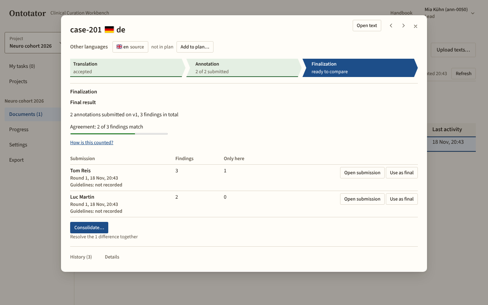
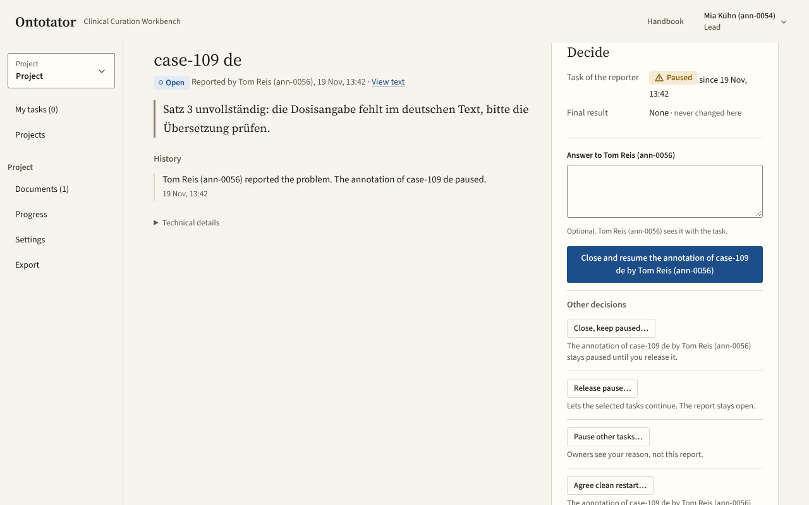
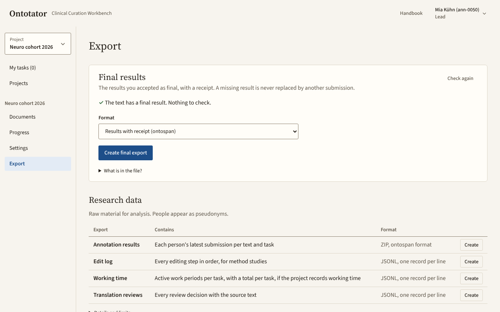

# Lead: results, decisions and export

This chapter is for project leads. It covers choosing the final result of each text, consolidations, the decisions on translations, text changes and problem reports, and the export. Back to the [lead overview](lead.md).

## Accepting results and consolidation

Each text version gets one final result: one submission or one consolidation that you accept. Only final results go into the final export. You do this in the **Finalization** part of the [text card](lead-documents.md#the-text-card).

How to choose:

- If all submissions agree, accept one.
- If they differ in a few findings and one is clearly right, read them and use that one.
- If they differ and you want each difference decided on its own, start a consolidation.

### Accept a result or compare results

What for: choose the final result of a text.

1. On **Documents**, tab **Needs your decision**, click **Accept result…** or **Compare results…** in the row. The row reads **Accept result…** when there is one result to accept or the submissions agree in full, also on notes and modifier text spans, and **Compare results…** when they differ in anything. The card opens at **Finalization**.
2. With one submission or a submitted consolidation, check it and click **Accept result**. For a consolidation, the card says how its findings came about, for example *Consolidated by Carla Diaz · 32 matching, 1 decided by Carla, 2 groups left out*. Left-out groups are not in the result. If an annotator left findings **Unresolved**, the card lists them with who wrote each note. Accepting a submission directly keeps the flag and the note in the export; open the submission to check them first.
3. If all annotations agree, the card says so. Click **Accept result**. A finding an annotator left **Unresolved** never counts as agreed, so that text goes through the next step instead.
4. If they differ, the card shows the agreement, for example *Agreement: 5 of 9 findings match, 1 differs in context only*. When matching findings still differ in a note, a text span or a modifier text span, a line below names them, for example *Notes differ on 1 finding: Ataxia*. When people chose a term and its parent or child on the same passage, a line names the pair, for example *Related terms: Seizure / Status epilepticus*; it still counts as a difference. Findings an annotator left **Unresolved** count as differences and are listed with who wrote each note. **How is this counted?** explains the numbers. Open a submission with **Open submission** to read it in the read-only text view, where each finding and each modifier names its code. If that work was carried over from an earlier version of the text, tick **Show changes since** v1 above the text to see the changed passages ([See what changed since the earlier version](annotator.md#see-what-changed-since-the-earlier-version)).
5. Warning: the next action saves at once, without a confirmation. Click **Use as final** in the row of the submission you want (at phone width the submissions are listed one under the other, with their buttons below each). Or [start a consolidation](#start-a-consolidation) instead.

After saving, the card moves on to the next text that needs a decision. The decided row stays in the tab with a *Resolved* badge until you click **Refresh** or change the tab. To go back, [withdraw the final result](#withdraw-a-final-result) or [change it](#change-a-final-result).

If the project rule says the consolidator may not be an annotator, you cannot accept your own result; another lead must do it.

### Accept early while other annotations are open

What for: accept a result before everyone has submitted.

1. Open the text card at **Finalization**. It lists the annotations still open.
2. Optional: remove open work with **Remove…** in the warning.
3. Choose the result as in [Accept a result or compare results](#accept-a-result-or-compare-results).

Open work stays assigned unless you remove it.

### Start a consolidation

What for: let one person decide the differences between submissions and build one result.

Before you start: the text needs at least two submissions. The consolidator must have the **Consolidator** role in the project ([Change a member's roles](lead-settings.md#change-a-members-roles)), or be you.

1. In the text card, open **Finalization** and click **Consolidate…**. The form **Consolidate submitted results** opens with the compared submissions already ticked.
2. Under **Submissions to merge**, check the ticked submissions (at least two).
3. Under **Consolidator**, choose a person. The list starts with **Choose a consolidator**, then you (*You (Mia Lead)*), then every member with the Consolidator role; the hint under the list links **Settings → People**, where you give the role to someone who is missing. If the project rule forbids it, people who annotated this text are shown but cannot be chosen (*— Ana Weber annotated this text*).
4. If the person's profile lists languages but not the text's language, tick the box *Assign this consolidator despite missing en in their profile*, right under the list.
5. Optional: enter **Consolidation reason (optional)**. The consolidator sees it in **My tasks** and above the groups; it is also kept in the history.
6. Click **Start consolidation**.

If the button stays inactive, the form says why: *Select at least two submissions.*, *Choose a consolidator.*, *Confirm the consolidator despite missing en.*, or someone already has a consolidation in progress on this text. If that is you, the button reads **Continue consolidation**.

After the start:

- If you chose someone else: Ontotator sends no e-mail. Tell the person that a consolidation is waiting in their **My tasks**.
- If you chose yourself: you get the Consolidator role for this project. Click **Open consolidation** in the text card or **Open my task** in the text's row on **Documents**. Each opens your task, where you decide and submit.

While the consolidation runs, the card shows the consolidator and how many groups are still open. When the text has more than one version, the consolidator's row also names the version the consolidation runs on, for example *2 of 5 groups open · assigned 18 Oct by you · v1*. What the consolidator does is in the [consolidator chapter](consolidator.md). A consolidator who does not lead the project reads the submissions on the consolidation screen; the text view shows them their own results only, and its **Submissions** list names the submissions they consolidate without a link.

### Read a submitted consolidation

What for: see how a consolidation result came about before you accept it.

1. In the text card, click **Open consolidation**. Or, if the card shows flagged findings ("guidelines unclear"), click **Open** next to one to go straight to that group.
2. The heading reads, for example, *Consolidation of CASE-1 en v1*. The banner says who submitted it. The view is read-only.
3. In decided groups, the chosen value of each conflicting row is tagged **kept**, including the chosen passage and modifiers. The consolidator's notes show as *Note: …*, in the list under each closed group as well, and flagged groups show **Flagged: guidelines unclear**. Added findings say who added them and list their values.
4. Click **Back to documents**.

### Accept a consolidation

What for: make a submitted consolidation the final result.

1. Click **Accept result…** in the row.
2. Read the consolidation first ([Read a submitted consolidation](#read-a-submitted-consolidation)). Pay attention to groups flagged **Flagged: guidelines unclear** and to the notes: they show where your guidelines need a clearer rule ([Publish the first or a new guideline version](lead-settings.md#publish-the-first-or-a-new-guideline-version)).
3. Click **Accept result**.

A submitted consolidation cannot be reopened or reassigned. If it contains a mistake, choose **Choose another result…** in **Finalization**, then **Consolidate…** to start a new consolidation; the earlier consolidation can be one of its submissions.

### Review changes to a final result

What for: confirm a final result after something changed, for example a newer submission or a corrected text. The row's next step is **Confirm final result**. Its **Finalization** cell says what changed, for example *Check changes, newer result*; *ready to accept* is a text that has no final result yet.

1. In the row, click **Review changes…**. The card lists what changed.
2. Optional: if the text changed, click **Show changes** to see the changed passages.
3. Choose one:
   - Keep the final result: **Keep the current final result**. If the text has several versions, the button names the version of the final result, for example *Keep final on v1*.
   - **Use the newer result**. If annotators marked findings in it **Unresolved**, the block lists them with who wrote each note.
   - Carry it to the new version, for example *Carry to v2…* (see [Carry submitted work to a new text version](#carry-submitted-work-to-a-new-text-version)).

### Change a final result

What for: pick another result after you already chose one.

1. Open the text card at **Finalization**.
2. Click **Change final…** next to **Open result**.
3. Click **Use as final** in the row of the result you want. It saves at once; the card stays on this text and says *Final result saved for EN100022 en.* Each result names the guideline version it was made under, for example *Guidelines v2 (current: v3)*, or *Guidelines 3.1 (v2) (current: 3.2 (v3))* when the versions have your own numbers ([Publish the first or a new guideline version](lead-settings.md#publish-the-first-or-a-new-guideline-version)).

The message *Final result of EN100022 en changed.* has an **Undo** button, also while the card is open. It brings the earlier final result back (*The earlier final result of EN100022 en is back.*), under the same rules as the Undo of **Change final…** for several texts: for the lead who made the change, once, within an hour, and refused once something the final result rests on changed since ([Accept or change the final result of several texts](#accept-or-change-the-final-result-of-several-texts)). The same message follows **Use the newer result** under *Review changes…*. After the Undo, the green line *Final result saved for EN100022 en.* in the card goes: it spoke of the result that is no longer final. A first choice of a final result has no Undo: use [Withdraw a final result](#withdraw-a-final-result). **History** in the card lists each change and its Undo.

While a text has a final result, its annotation mode cannot be changed: **Change mode…** is refused (error code `ANNOTATION_MODE_FINAL_SELECTED`) ([Change the annotation mode of one text](lead-documents.md#change-the-annotation-mode-of-one-text)). To take the final result back instead, see [Withdraw a final result](#withdraw-a-final-result).

### Withdraw a final result

What for: take a final result back, for example before finished texts are annotated again.

1. Open the text card at **Finalization**.
2. Click **Withdraw final…** next to **Change final…**.
3. Read what happens: the text has no final result until you choose one again; final exports already made stay as they are; **Change mode…** is possible again; submissions and consolidation stay.
4. Enter the **Reason**, tick **I understand** and click **Withdraw final result**.

The text asks for a final result again, and its submitted annotations can get a new work round again: **More actions** › **Start a round…** skips texts with a final result ([Start a new round for several texts](lead-documents.md#start-a-new-round-for-several-texts)), and so does **More actions** › **Change mode…** ([Change the annotation mode of several texts](lead-documents.md#change-the-annotation-mode-of-several-texts)). **History** in the text card shows the withdrawal with your reason. If someone changed the final result meanwhile, nothing is withdrawn: the dialog says *This final result changed. Nothing was withdrawn.* and loads the current one. Check it, then tick **I understand** again to withdraw it, or click **Cancel**.

### Accept or change the final result of several texts

What for: settle many texts at once on **Documents**: accept every selected text whose annotations agree, or move final results to newer submissions after a second round, a reopened annotation or a consolidation.

1. On **Documents**, select the texts, then click **More actions** in the selection bar.
2. Choose one. An entry that does nothing for the selection stays in the menu, unavailable, and says why, for example *No selected text has a newer submission than its final result.* With one text selected, it reads *The selected text has no newer submission than its final result.*
   - **Accept agreeing results…** is for texts without a final result. A text gets one when at least two annotations are submitted, nothing else is open on it and all findings agree in full, also on notes and modifier text spans. It never replaces a final result.
   - **Change final…** is for texts that have a final result. The newest submission of the text on the current version replaces the final result when it was submitted after the final result was chosen and is a consolidation, the text's only submission, or an annotation that agrees in full with the text's other submissions (as for **Accept agreeing results…**). A submission that was already there when a lead chose the final result does not replace it, and submissions that differ are never chosen for you.
3. Read the preview. It groups the texts by what happens to them; click **Show all** to list every text of a group.
   - **Accept agreeing results…**: *Accept the result of 38 texts · all annotations agree in full*; the texts left out, each group with its reason, for example *Skip 3 texts · the results differ: consolidate or choose in the text card*; and *Keep 12 final results · already final: use Change final… for them*.
   - **Change final…**: *Use the newest consolidation for 5 texts · Carla Diaz 5* and *Use the newest annotation for 3 texts · Tom Reis 2, R. Roe 1* name whose submission becomes final. Texts are skipped when they have no final result yet, other work on them is still open, nothing is submitted on the current version, the final result already is the newest submission, nothing was submitted since the final result was chosen, the newest submission is your own and the project rule says another lead must choose it, or the submissions differ (*Skip 2 texts · submissions differ: compare or consolidate first*).
4. Click the button that names the work, for example *Change 8 final results*. The dialog lists what happens. Tick **I understand** and click the button again.

Every listed text changes, or none: if a text or a final result changed since the preview, the dialog says *The texts changed since the preview. Check the new preview.* and shows it. Each text is recorded like a single **Accept result** or **Change final…**, so its **History** shows it.

- For texts skipped because the submissions differ, open the text card and compare them, or [start a consolidation](#start-a-consolidation); a submitted consolidation is then the newest submission.
- Warnings you acknowledged for the earlier final result do not carry over to the new one. Final exports already made stay as they are.
- **Change final…** can be undone: the message, for example *Changed the final result of 8 texts.*, has an **Undo** button. It brings back the earlier final result of every text, with the lead who had chosen it, the time of that choice and the warnings that lead had acknowledged; the message then reads *The earlier final results of 8 texts are back.* and the change is offered again. Undo is for the lead who made the change, once, within an hour, and it restores every text or none. It is refused when a text changed since: its final result was changed, confirmed again or withdrawn; a version of the text was added, discarded or restored; its work plan changed; a task of the text was assigned, reopened, withdrawn or paused, or got a new round (a decision on a problem report that pauses or restarts a task counts); or something was submitted. The message names the first such text and why, for example *Undo is not possible: 1 of 8 texts changed since (EN100023 en: its final result was changed, confirmed again or withdrawn). Nothing was undone.* Then use **Change final…** in the text card ([Change a final result](#change-a-final-result)).
- A final export made between the change and its Undo does not stop the Undo. It stays as it is and holds the changed results; the message says so, for example *The earlier final results of 8 texts are back. 1 final export made meanwhile stays as it is, with the changed results.* Export again to get the earlier results. Agreement numbers are not stored: a later export computes them from the restored final results.
- Undo is recorded as a change of its own: each text gets a new entry in the audit trail, and its final result a new revision.
- **Accept agreeing results…** has no undo. To go back, use **Withdraw final…** or **Change final…** in the text card ([Withdraw a final result](#withdraw-a-final-result), [Change a final result](#change-a-final-result)).

## Translation and text-change decisions

### Read the translation reviews of a project

What for: judge one reviewer's work, and read what reviewers wrote, without opening every text card.

1. In the sidebar, click **Progress**, then **Translation reviews**. **Progress** stays marked in the sidebar while the list is open; **Progress** at the top of the page leads back.
2. The list has one row per submitted translation review, newest first, and one per review that is assigned but not submitted (*Open*, always last). Each row shows the text (case ID, language, version), the reviewer, the decision, whether the change is clinically relevant, the categories, the rationale, the number of changed passages and when it was submitted.
3. Filter with **Person**, **Decision** and **Language**; **Order** turns the list to **Oldest first**. The address keeps the filters, so the list is as you left it when you come back from a text. The list shows 25 reviews per page; **Previous** and **Next** change the page.
4. Click **Compare versions** in the row of a review that was accepted with corrections. The text view opens with the reviewed version on the left and the corrected version on the right; tick **Show changes** to see the passages ([Read a text and other people's work in the text view](lead-documents.md#read-a-text-and-other-peoples-work-in-the-text-view)). Every other row has **Open text**, which opens the reviewed version: a query or a rejection creates no version, and an unchanged text has nothing to compare.

Read the **Rationale** column also for accepted reviews. A reviewer who accepts a translation may note a problem there that does not change the translation, for example an odd dose that the source also has. No other page shows such a remark.

The **Changes** column counts each changed place once, by words: a replaced wording is one passage. **Show changes** counts added and removed passages separately, so its numbers can be higher. A change of spaces or line breaks only is not counted. *Not counted* means the two texts differ too much to count.

Only leads and system administrators can open the list. To decide a query or a rejection, go on with the next section.

### Answer a question

What for: answer a question a person asked with **Ask the lead** (today in a translation review). Their task stays open while you answer, unless they chose to pause it.

1. In the sidebar, click **Questions**. The count shows the open ones, for example *Questions (2)*.
2. The **Open** tab lists each question with who asked, the task and text, the question and, if given, the passage with the proposed wording marked as changes.
3. Click **Answer…**, write **Your answer**, and click **Send answer**.
4. With a proposed wording, tick **Take the proposed wording into the reviewer's text** to put it into their open review in the same step; the button then reads **Answer and take the wording**. The reviewer still checks the text and submits the review. If the passage is no longer in their text, the answer is refused with the wording; send it without.

The answer appears in the person's task under **Questions to the lead**. Answered questions stay under **Answered**. A question is no problem report: it does not show on **Documents** and does not hold the export.

### Resolve a rejected or queried translation

What for: decide what happens after a reviewer rejected or queried a translation. The row's next step is **Resolve rejected translation** or **Resolve queried translation**. It always concerns the newest version that was rejected or queried. For example, after you took the reviewer's text as v2 and asked a reviewer to correct v2, a query on v2 is decided at v2: the dialogs name *v2* and the button reads *Accept v2*.

1. In the row, click **Resolve…**. A dialog opens. First it shows what the reviewer said: who rejected or queried the version, the reason and the categories. For a query, **Show the proposed text** shows the text the reviewer proposed, with the changes marked, for example *Show the proposed text (2 passages changed)*. When someone holds an annotation that waits for this translation, a line names them, for example *Ana Weber is waiting for this decision to start the annotation.*
2. For a rejected translation the main button is **Correct it myself (counts as accepted)…**: you correct it yourself ([Correct a translation yourself](#correct-a-translation-yourself)). If the version is itself a correction of an accepted version, it reads **Correct it myself (reviewed again)…**. While you hold a correction, it reads **Continue your correction**.
3. For a query (queries come from reviews made before **Ask the lead**), decide it yourself with one of the two buttons. Each closes the query as your decision, and the reviewer reads your answer at their submitted task (**My tasks**, *Answer from the lead*):
   - **Accept the reviewer’s text as v2…** (the main button): the dialog shows the reviewer's question and, under **Reviewer’s text**, the text they proposed; you can still change it. Below it the changes against the version are marked, for example *Changes to v1 · 2 passages changed*, with added words underlined and removed words struck through. **Answer to the reviewer** is optional here. Click the button that names the new version, for example *Accept as v2*: the text becomes the next version, a correction of the queried one, and is accepted. If people annotated the queried version, the dialog says so before you save, as in [Correct a translation yourself](#correct-a-translation-yourself). If the reviewer proposed no change, this button is not offered and the dialog says *Ana Weber proposed no change to the text.*
   - **Accept v1 as it is…**: the translation is right and the reviewer asked about something else, for example the source. Write the **Answer to the reviewer** (required) and click the button that names the version, for example *Accept v1*: the version is accepted without changes. A text the reviewer proposed is not taken.
4. Or click **Other ways…** and choose one of its items. Each item says in one line when to use it:
   - The reopen item, for example *Reopen Ana Weber's review…*: the same person reviews it again. Enter an optional **Reason (optional)** and click **Reopen review**. Their task shows **Reopened** with your reason (in **My tasks** behind the badge, in the review above **Decision**) and starts from the version's current text; their earlier decision stays in the history. If they then accept it with corrections, the corrected text becomes the next version.
   - **Assign a new review…**: someone else reviews it. The person who already reviewed it shows *Review submitted* with **Reopen their review…**; a new assignment for them is not possible, reopen their review instead. After **Fix typos (no review)…** on the rejected or queried version the review is a review of the corrected version, there is no reopen item, and the person who reviewed the earlier version can be assigned again ([Fix a typo in a translation without a review](#fix-a-typo-in-a-translation-without-a-review)).
   - For a query, **Correct it myself (counts as accepted)…**: you correct it yourself ([Correct a translation yourself](#correct-a-translation-yourself)). The correction starts from the text of the version, not from a text the reviewer proposed; to start from the reviewer's text, use **Accept the reviewer’s text as v2…**.
   - The discard item, for example *Discard the de translation…*: enter a **Reason** and click **Discard**. Nothing is deleted; the versions are marked as discarded.
   **Cancel** in a step brings you back to the choice.
5. Or click **Cancel** (or press `Escape`). Changing a filter, the tab, the order or the page also closes the dialog; nothing is saved until you choose.

After a decided query the row goes on with the accepted version, for example **Assign annotation…**, and people who waited for the decision can start. The version row names the decision, for example *Accepted: decision on the query of Ana Weber (ann-0003), the reviewer’s text taken, Project lead (ann-0002), 18 Nov, 10:12 · Answer: Yes, as proposed.* (*the version kept as it is* after **Accept v1 as it is…**; *taken with changes* when you changed the reviewer's text). **History** has a line for it, for example *query decided by you, the reviewer’s text taken, v1 → v2, 18 Nov, 10:12: Yes, as proposed.*, and the audit log records the decision with the answer. The decision is refused, and the dialog says so, while a translation review of the version is open, when a newer version exists, when the translation was discarded and when the query was already decided. After **Fix typos (no review)…** on a queried version you decide the query at the fixed version: its text is compared with the reviewer's text.

### Correct a translation yourself

What for: fix a queried, rejected or accepted translation without assigning another review.

1. For a queried or rejected translation: in the row, click **Resolve…**, then **Correct it myself (counts as accepted)…** (for a query under **Other ways…**; or **Continue your correction**). For an accepted translation: open the text card, click **Translation** and, at the newest accepted version, click **Edit the translation…**, choose **The meaning changes** and click **Continue**.
2. Read the panel: you review the version yourself, and your corrected text becomes the next text version. After a rejection or a query, it counts as accepted. A correction of an accepted version starts as a correction with review On: it is reviewed again before annotation moves to it. If people annotated the accepted version, the dialog says so before you start, for example *Annotation has work on v1. 3 annotations (2 submitted, 1 open) stay on v1. After saving, the row offers Handle text change…*. The dialog also names open consolidations and a final result on that version; they stay on it too. Nothing is carried automatically. If the reviewer rejects or queries your corrected version and you correct it once more, that next version is reviewed again as well; to take it without a review, use **Accept this version…** ([Accept one translation version](#accept-one-translation-version)). If your profile lists languages but not this one, tick *Correct despite missing de in your profile*. Without a qualification in your profile, the panel links to **Add your qualification in your profile**; after saving, **Back to Documents** returns you to the texts.
3. Click **Open translation review**. The screen says **You are correcting this translation as project lead.** (for an accepted version: **You are correcting this accepted translation as project lead.**)
4. Correct the translation as described in [Review a translation](annotator.md#review-a-translation). Only **Accepted with corrections** is offered.
5. Submit with **Submit review…** (or `Ctrl+Enter`), then click **Back to Documents**. If your text has spacing errors or invisible characters, the confirmation names them, for example *1 typography hint in your text: double space.*; **Show them** shows the places, **Keep editing** lets you fix them. The line blocks nothing.
6. After the correction of an accepted version, assign the review of the new version as usual. The annotation work on the old version is handled with **Handle text change…** and *Carry to v2…* ([Handle a text change for open annotation work](#handle-a-text-change-for-open-annotation-work)); with **Annotate only after the translation review is accepted** on, the row offers them once the new version is accepted.

While your correction of an accepted version is open, **Ask a reviewer to correct…** for the same version is refused (*A lead is correcting this version.*): submit your correction first, or withdraw it with **Remove…** in your row of the **Translation** part.

To give a reviewer you asked with **Ask a reviewer to correct…** more to look at, add to the reason with **Add to the reason…** in their row of the **Translation** part while the review is open ([Add to the reason of a correction request](lead-documents.md#add-to-the-reason-of-a-correction-request)). The reason as sent is never changed. The reason of **Reopen…** has no such addition.

### Accept a translation that was not reviewed

What for: annotate a translation that was reviewed outside Ontotator. The row's next step is **Translation not accepted**.

1. In the row, click **Assign review or accept…**.
2. Choose one:
   - Click **Turn translation review on**, then assign a review.
   - Tick **This translation was reviewed outside Ontotator — accept it as it is**, enter a **Reason** and click **Accept and annotate**.

Ontotator records the acceptance with your name, the reason and the time. It accepts the newest version of every translation of the text, parallel translations included. To accept only one of them, use [Accept one translation version](#accept-one-translation-version). To have an accepted translation reviewed after all, click **Assign a new review…** in the **Translation** part of the text card.

### Accept one translation version

What for: accept exactly one version, for example an imported correction that was checked outside Ontotator, without touching the other translations of the text.

1. Open the text card and click **Translation**.
2. At the version, click **Accept this version…**. It is offered at the newest version of a translation that is neither reviewed nor accepted.
3. Enter a **Reason**, for example *Checked against the DeepL output*. The dialog says how the acceptance will read: *It is recorded as “Accepted: reviewed outside Ontotator”, with your name, the reason and the time: no translation review in Ontotator stands behind this version. Say in the reason how it was checked.* Do not use this to decide a query: under **Resolve…**, **Accept the reviewer’s text as v2…** and **Accept v1 as it is…** record your decision on the query and tell the reviewer ([Resolve a rejected or queried translation](#resolve-a-rejected-or-queried-translation)).
4. Click the button that names the version, for example *Accept v2*.

The version then reads like other acceptances, for example *Accepted: reviewed outside Ontotator, Project lead (ann-0002), 14 Nov, 19:40, Checked against the DeepL output*. While a translation review of the version is open, the acceptance is refused: withdraw the review with **Remove…** first.

### Upload a new version of a translation

What for: bring in a text made outside Ontotator, for example a new machine translation, a translation by a person or a version you corrected by hand, as the next version of one translation.

1. Open the text card and click **Translation**.
2. At the newest version of the translation, click **Upload a corrected text…**. The dialog says which version the text becomes, for example *The text becomes v3, a correction of v2.*
3. Give the text: with **Paste text**, paste the whole text into **New text**; with **Choose file**, choose one UTF-8 text file (.txt). The file only fills the text; its name does not matter.
4. Under **How was this text made?**, choose **Machine translation**, **Human translation** or *Correction of v2 by hand*. For a machine translation, enter the **Provider** (for example DeepL); **Model or tool** is optional. **Made on**, **Made by** and **Note** are optional as well.
5. Click **Check changes**. The dialog shows the changes against the current version, for example *Changes to v2 · 2 passages changed*, with added words underlined and removed words struck through. **Back** returns to the text.
6. Click the button that names the new version, for example *Save as v3*.

The new version is always a correction of the version you started from. It starts as *Ready for review* and sets **Review** to **On** for the text; nothing is accepted by the upload. Assign a translation review as usual, or accept the version with **Accept this version…** if it was reviewed outside Ontotator ([Accept one translation version](#accept-one-translation-version)). The version row then shows how the text was made and who uploaded it, for example *Correction of v2 · Machine translation, DeepL, deepl-2026-10* and *Uploaded by Project lead (ann-0002), 16 Nov, 10:12 · Made on 12 Nov 2026 by Dr. Roe · Checked against the source*.

If people worked on the current version, the dialog says so before you save, for example *Annotation has work on v2. 3 annotations (2 submitted, 1 open) stay on v2. After saving, the row offers Handle text change…*. Open consolidations and a final result stay on that version too. Handle them afterwards with **Handle text change…** and *Carry to v3…* ([Handle a text change for open annotation work](#handle-a-text-change-for-open-annotation-work)).

The upload is refused in these cases:

- A translation review of the version is open: *A translation review of this version is open.* Withdraw it with **Remove…** in the reviewer's row of the **Translation** part first.
- The text is the same as the current version: *No changes to v2. Nothing is saved.* A line break at the end of a file does not count as a change.
- The file is not a .txt file, is not UTF-8 or is larger than 1 MB.

A source text has no **Upload a corrected text…**: a corrected source text comes in as an Ontospan bundle ([Corrections and parallel translations in a bundle](lead-documents.md#corrections-and-parallel-translations-in-a-bundle)). The same applies to a parallel translation that should stand beside the current one. An exported Ontospan bundle does not yet carry the provider and model of an uploaded version; they are kept in Ontotator.

### Fix a typo in a translation without a review

What for: correct spacing, a typo or grammar in a translation without a translation review. The content of the text stays as it is, and an accepted text stays accepted. Ontotator calls this an editorial correction; the API, the MCP tool and the name of the action in the audit trail use that term.

1. Open the text card and click **Translation**.
2. At the newest version of the translation, click **Edit the translation…**, choose **Only spelling, spacing or grammar** and click **Continue**. Where the version is not accepted, the button is **Fix typos (no review)…** and opens the dialog at once. Unlike **The meaning changes** and **Upload a corrected text…**, it keeps the status of the text and starts no review.
3. Correct the text under **Corrected text**. It starts with the text of the version. The words you change are marked while you type, and the changes appear below the field with removed text struck through and a count, for example *Changes to v2 · 1 character changed*.
4. Under **What did you fix?**, click **Spacing**, **Typo**, **Grammar** or **Removed addition** (words the machine added that the source does not have, for example a synonym in brackets); you can choose several. **Note** is optional, for example the word you corrected. One of the two is required and is kept with the version.
5. Read what happens to the work on the version (see below) and the status line, for example *v3 keeps the status of v2: Accepted. No translation review is started.*
6. Click the button that names the new version, for example *Save as v3*.

If a number changes, the dialog points it out, for example *Changes a number: 15 → 50. Check that this is intended.*; you can still save.

The corrected text becomes the next version of the translation, a correction of the version it fixes with that version's status: the correction of an accepted v2 is an accepted v3, and v2 stays accepted as well. A version that was rejected or queried can be corrected too: its correction is rejected or queried like it, and you resolve it as before ([Resolve a rejected or queried translation](#resolve-a-rejected-or-queried-translation)). The corrected version is then the text of the row: **Assign a new review…** and **Assign review…** assign a review of it (the dialog names the version, for example *case-0102 de v2*, and names a review of an earlier version apart, for example *Nobody assigned yet · Earlier: Ana Weber (ann-0003) reviewed v1*), the reviewer reads the corrected text, and **Translation details** in the review says *Typos fixed by the project lead on …* with what you fixed. The version you corrected takes no further review: its submitted review has no **Reopen…**, and the options under **Resolve…** have no reopen item; assign the review again instead, also to the person who reviewed the earlier version. If the reviewer rejects or queries the corrected version, it stays the text to resolve. No translation review is started and **Review** is not changed. The version row names the correction, for example *Typo fix by Project lead (ann-0002), 17 Nov, 10:12 · Spacing; Typo*, and **History** has a line for it, for example *typos fixed in v3 by you, 17 Nov, 10:12: Spacing; Typo*. On Documents the **Translation** state of an accepted text you corrected reads *Accepted, typos fixed by you, v2 → v3* (on a wide screen *accepted* with the marker *v3 corrected*). The audit log records who corrected the text, the changed passages and the reason.

What happens to work on the corrected version:

- If nobody annotated it, the dialog says so: *Nobody has annotated v2 yet.*
- If the version has a submitted translation review, the dialog says that the review stays with the version it reviewed: *A submitted translation review stays with the version it reviewed.* For a rejected or queried version it adds how the new version gets its review, for example *To have v3 reviewed, use Resolve… › Other ways… › Assign a new review… on this row after saving.*
- Annotation tasks nobody opened move to the new version: *2 waiting tasks continue on v3.* A task from tool proposals moves only when no tool proposal waits for a check after the fix; it moves a few seconds after you save, once the proposals are on the new version. The dialog names the rule: *A task from tool proposals continues on v3 only when nobody opened it and no proposal waits for a check.*
- In the block *Work stays on v2*, each reason stands on its own line, and the rule for tasks from tool proposals follows below them. A task that stays is named with the reason, for example *Task not moved, already opened: Eva Lang.*, *Task not moved, the task is paused: Tom Reis.* or *Task not moved, from tool proposals, and a proposal waits for a check: Ana Weber.* Before you change the text, the dialog says that it will name whether a task from tool proposals continues. Move such a task afterwards with **Handle text change…**, choosing to move it to the new version ([Handle a text change for open annotation work](#handle-a-text-change-for-open-annotation-work)); decide the report of a paused task first.
- A submitted annotation moves to the new version by itself when every finding is placed on the new text without doubt and the fix changes no number: nobody clicks, and the person does not submit again. Under the changes, the dialog says per person whose annotation moves and whose does not, and why, for example *Moves to v3 by itself, nobody submits again: the annotation of Tom Reis.* and *Not moved by itself, a finding marks words you changed: Ana Weber.* What moves stands above the highlighted block *Work stays on v2*, which names only what stays. Before you change the text, the dialog says that it will name who moves once you do. An annotation does not move by itself when the fix changes a number (a digit added, removed or changed anywhere in the text; *0.5* → *0,5* or *12.03.* → *12. 03.* is no change of a number, *12* → *1 2* is one), when the text has a final result or a consolidation, when the translation is not accepted yet, when it was annotated from tool proposals (they reach the new version later), when the task is paused, or when a finding marks words you changed. The moved annotation is the same person's annotation: same findings and guideline version, placed on the new text, and the task on the old version goes away. It is not a second annotation: agreement, the comparison of the findings (also *Related terms*), consolidation groups, the counts on Documents and Progress and the work export are the same as before the fix, and it adds no working time. It keeps the time the person submitted, also in **Finalization**, **Consolidate…**, the text view's **Submissions** and the person's task. **Finalization** offers it once, on the new version: the original on the old version is no second choice there. Opened in the text view, it shows no carried findings, as the person checked nothing. **History** has a line for it, for example *annotation of Tom Reis (ann-0004) moved to v3 by itself after the typo fix, 17 Nov, 10:12*, and the audit log records it with the submission it came from. To let the person look at it again, reopen the task on the new version as usual. After saving, the message says how many moved, for example *1 annotation moved to v3.*
- Other annotations that were opened or submitted, open consolidations and a final result stay on the corrected version. Only then the dialog shows a highlighted block, *Work stays on v2*, with what stays and what to do, for example *2 annotations stay on v2. After saving, use Handle text change… and Carry to v3… on this row to move them.* Move started work with **Handle text change…** ([Handle a text change for open annotation work](#handle-a-text-change-for-open-annotation-work)) and submitted work with *Carry to v3…* ([Carry submitted work to a new text version](#carry-submitted-work-to-a-new-text-version)). The block also says how many findings of the annotations that stay mark words you changed and will need a check, for example *1 of 2 findings marks words you changed and will need a check when moved.*
- Tool proposals move to the new text; a proposal whose marked words were changed waits for a check, as after a corrected translation review.

The correction is refused in these cases, and the dialog says so in place:

- A translation review of the version is open: *A translation review of this version is open.* Withdraw it with **Remove…** in the reviewer's row of the **Translation** part, or make the fix in that review.
- The version is not the newest of its translation or it was discarded.
- The text is unchanged: *No changes to v2. Nothing is saved.*

A source text has no **Fix typos (no review)…**; a corrected source text comes in as an Ontospan bundle. A change of content, for example a different finding or a rewritten sentence, belongs in a translation review ([Correct a translation yourself](#correct-a-translation-yourself)).

The same correction can be made without the browser: the MCP tool `editorial_correction` ([MCP server guide](../../mcp/README.md)) and `POST /api/v1/projects/{key}/documents/{document_id}/editorial-correction` take the passages to replace, each with its replacement, and the reason, with a project token of a lead that has the scope *Project administration*. Without `confirm` the tool changes nothing and returns the changed passages and what would follow. It lists the tasks that stay in `tasks_staying`, each with its reason, and names `move_task_to_version` as the next step for them.

### Handle a text change for open annotation work

What for: decide what happens when a text gets a new version while someone is still annotating the old one. The row's next step is **Handle text change**.

Before you start: if the task is paused by a problem report, [decide the report](#decide-on-a-problem-report) first. To see what changed, compare the two versions in the text view with **Show changes** ([Read a text and other people's work in the text view](lead-documents.md#read-a-text-and-other-peoples-work-in-the-text-view)).

1. In the row, click **Handle text change…**. A task on a correction that was not accepted only offers **Withdraw**. The dialog says why and what to do next.
2. Choose one:
   - Move to the new version: the annotator continues on the corrected text; their draft findings are carried and marked for checking. In a task from proposals their decisions on the proposals are carried, and only what needs a check is marked.
   - Let the annotator finish on the old version: the result is carried to the new version for them to check.
   - **Withdraw**: the task ends, nothing of the draft is carried, and the new version needs a new annotation. Assign it afterwards.
3. Click **Apply**.

Work from proposals is carried too: the decisions on the proposals move to the matching proposals of the new version, and only what touches a changed passage is marked **Check needed**. An accepted, edited or Unresolved proposal without a counterpart in the new version becomes the annotator's own finding and is marked **Check needed** too; an Unresolved one keeps its note. A rejected proposal without a counterpart is dropped. If the new version has no proposals yet, the dialog says so: their automatic transfer may still be running, or they must be imported. Until then the move and finishing on the old version are not available, and nothing is preselected. Wait for or import the proposals for the new version, then click **Retry**, or choose **Withdraw**. To annotate the new version from scratch instead, [change the annotation mode of the text](lead-documents.md#change-the-annotation-mode-of-one-text); that discards the work of the whole text.

### Carry submitted work to a new text version

What for: reuse submitted findings after the text was corrected. The row's next step reads, for example, *Carry to v2…*.

Before you start: to see what changed, open the text view of the old version, click **Compare**, choose the new version on the right and tick **Show changes** ([Read a text and other people's work in the text view](lead-documents.md#read-a-text-and-other-peoples-work-in-the-text-view)).

1. In the row, click the carry button, for example *Carry to v2…*.
2. Choose who continues: the author, **Someone else…** (then pick the **Annotator**), or start the new version fresh, for example *Start v2 fresh*: nothing is carried, and the assign dialog opens next.
3. Click **Assign**.

A submission is carried to a version once. If you withdraw or remove the carried task before the person submits it, the row offers the carry again, for example *Carry to v2…*. The fresh start, for example *Start v2 fresh*, is final.

Work from proposals is carried too: the decisions on the proposals move to the matching proposals of the new version, and only what touches a changed passage is marked **Check needed**. An accepted, edited or Unresolved proposal without a counterpart in the new version becomes the annotator's own finding and is marked **Check needed** too; an Unresolved one keeps its note. A rejected proposal without a counterpart is dropped. If the new version has no proposals yet, the dialog says so: their automatic transfer may still be running, or they must be imported. Wait for or import the proposals for the new version, then click **Retry**. To annotate the new version from scratch instead, [change the annotation mode of the text](lead-documents.md#change-the-annotation-mode-of-one-text); that discards the work of the whole text. Until the new version has proposals, the row's **Annotation** column reads *v1 work waits* with *v2 has no proposals yet*, and *Carry to v2…* is disabled with the hint *Import proposals for v2*; it works as soon as the proposals are there. To assign the new version anew instead, use the text card.

If **Assign** fails because the new version has no proposals, or because of a server or connection problem, the dialog offers **Retry**. Other refusals say why, without **Retry**.

The annotator must check the carried findings before submitting ([Review carried findings](annotator.md#review-carried-findings)).

## Problem reports

Annotators and reviewers can report a problem with a text. This pauses their task until you decide.

### Decide on a problem report

What for: answer a report and let the work go on.

1. On **Documents**, click **Decide on report…** in the row. Or click **Decide on report…** in the problem report's notice of the text card.
2. Read the report: who reported it, the reason and the history.
3. In the common case, write an optional answer and click the close-and-resume button, for example *Close and resume the annotation of CASE-1 de by Ana Weber (ann-0004)*. The page names a task by its kind, text and owner, not by a number.
4. For other cases, open **Other decisions** and choose one:
   - **Close report…** or **Close, keep paused…**: close it with an outcome for the reporter.
   - **Release pause…**: let paused tasks continue.
   - **Pause other tasks…**: pause other tasks on the same text or project.
   - **Agree clean restart…**: restart the task with a new round, after agreeing with the reporter. The annotator's own findings are not carried over. A task from scratch starts empty; a task from proposals starts again on the newest proposal set of the text, all proposals open, so a newer tool set reaches the task this way. The text card's **Annotation** then names that set; *Newer set available* goes away once every task of the text works on it.
   - **Reopen report…**: open a closed report again.
5. Confirm in the form that opens.
6. Click **Back to Documents**, or go to the next decision.

A final result is never changed here. If a task is still paused after the report was closed, the row shows **Resume task…**; click it and release the pause.

If a lead paused the text of the report ([Pause and release the work on texts](lead-documents.md#pause-and-release-the-work-on-texts)), the page shows **Paused by lead** under *Text*. That pause is separate: after you close the report and release its pause, the task stays paused, marked **Paused by lead** for its person, until the text is released; the message after your decision says so. **Agree clean restart…** is refused while the text is paused.

## Export

### Export final results

What for: download the accepted final results.

1. In the sidebar, click **Export**. Or click **Export final results…** on **Documents** or **Progress**.
2. The card **Final results** checks every text. It lists texts that need your decision and texts left out because they have no final result. Texts with annotation off in the work plan that still have a final result are listed under **Not planned, not exported**, for information only; they are not exported. Texts with annotation off and no final result are not listed. If you took texts out of the work plan, a line below the check counts them all and names the file that lists them, for example *4 texts taken out of the work plan are listed in planned-out.csv* (with Phenopackets: *… in README.txt*).
3. Under **Format**, keep **Results with receipt (ontospan)**, or choose **Phenopackets (derived, lossy)**; see [Phenopackets](#phenopackets).
4. If texts need your decision or are left out, a tick box names how many results are exported and how many texts are left out, for example *Export the 3 results as they are; leave out the other 243 texts*. Tick it to export now anyway. Without the tick, **Create final export** does not start. The export's README.txt lists the left-out texts and the warnings you acknowledged with this tick. Left out here means planned for annotation but without a final result.

   Texts you took out of the work plan (annotation set to off after it was on) are named too: README.txt and index.csv list them, and planned-out.csv gives for each the plan revision, the time and the reason you entered in **Plan…** or when you discarded the translation. The Phenopackets ZIP names them in README.txt and lists them under `planned_out` in receipt.json. A final result such a text had stays in Ontotator and is not exported. Texts that were never in the plan are not listed.
5. Click **Create final export**.
6. When it is ready, click **Download (ZIP)**.

Click **Check again** after you accepted more results. **What is in the file?** explains the contents of the chosen format. With **Results with receipt (ontospan)**, the results are in selected-results.ontospan.zip, an Ontospan bundle. Besides the results, the file holds tables for analysis: every finding with its values, origin and text passages (findings.csv), the agreement between the annotators of each text, per text and for the whole project (agreement.csv, agreement-summary.csv), and what the annotators did with each tool's proposals, with the tool's precision and recall against the final results (proposals.csv). If you took texts out of the work plan, planned-out.csv names them with the reason. For a text you accepted directly, the file also holds the other annotations of it in compared-results.ontospan.zip, marked *compared*, so that the agreement covers it; they are not final results. Agreement is given as F1 values only. Values that annotators never confirmed are marked as *defaulted* in the file; proposals still unresolved in an accepted submission keep their reviewer flag and note. Once a consolidator decides such a group, the result is a normal decided finding, or no finding if left out, and the annotator's note stays in the provenance part of the export. The file formats are described in the [scientific workflow guide](../scientific-workflow.md) and the [translation review export guide](../translation-review-export.md).

Each text in an export names the ontology release its work was made under, which can be older than the project's current release. If the texts of one export were made under different releases, the newest keeps the layer ID (for example `hpo-layer`) and each older release gets a layer of its own (`hpo-layer@<start of its checksum>`), which the file lists with its release and checksum.

### Phenopackets

What for: hand the final results to tools that read GA4GH Phenopackets (schema v2).

The Phenopackets come from the same check and the same accepted results as the results with receipt; nothing is selected again. The ZIP holds one Phenopacket per text, a report per text of what was left out, a summary (report.json), a README.txt and the selected results themselves as an Ontospan bundle (selected-results.ontospan.zip). The Phenopackets are derived and lossy; the Ontospan bundle is the complete record, the same file as the selected results in **Results with receipt** made from the same check.

- Only findings about the patient on the HPO layer become phenotypic features. Findings about family members or other persons, with an unknown experiencer, with assertion *uncertain*, or left unresolved in consolidation are left out and counted in the reports. Findings of other layers are skipped.
- Assertion *absent* becomes an excluded feature.
- Time: a feature gets an onset only from an onset modifier of the finding, for example *Childhood onset*. A historical finding is exported like a current one, because a Phenopacket cannot say "in the past"; the reports count these, and the Ontospan bundle keeps the temporality.
- Each feature points to its finding in the Ontospan bundle of the same ZIP, so you can look up the text passage it was found in.
- Each Phenopacket is named after the text (its document ID), which is also the subject. Texts of the same patient are not grouped into one Phenopacket yet.

An operator can create the Phenopackets of the newest final export on the command line, with `ontotator admin export PROJECT OUT.zip --format phenopacket`.

### Export research data

What for: download raw material for analysis. People appear as pseudonyms.

1. On **Export**, go to **Research data**.
2. Choose a row: **Annotation results**, **Edit log**, **Working time** or **Translation reviews**. **Working time** holds data only if the project records working time ([Record working time](lead-settings.md#record-working-time)).
3. Click **Create**, then **Download** when it is ready.

Download an export within 24 hours: the server then deletes its file, and you create the export again. You can have at most 3 exports and uploads waiting at a time; one more is refused until one of them has started.

How to analyse these files is described in the [scientific workflow guide](../scientific-workflow.md).

### Export history

What for: find an earlier export again, see who made it and why one failed.

**Export history** at the bottom of **Export** is closed at first; click it to open the list. It lists every export of the project, newest first: final results, Phenopackets and the research data, also those that other leads or an API token started. Each row shows the export, its state (*Waiting*, *Running*, *Ready* or *Failed*), who requested it (*Command line* for one started on the server), when it started (to the minute) and how long it ran, for example *4 s* or *1 min 12 s*; *–* while it is still waiting or running. Point at the duration for the exact start and finish times. A failed export shows its error code under *Failed*; point at it for the full message.

- Click **Download** to save the file of a finished export again, within 24 hours of the export. Then the server deletes the file and the row has no **Download** any more: create the export again. The server checks your rights again on every download.
- Click **Show older exports** for the next 20.
- While the list is open, it updates when you create a research export here. Click **Refresh history** to see a final export or exports others started meanwhile.

Only leads and system administrators see the history. People appear by name and pseudonym, as elsewhere for leads.
